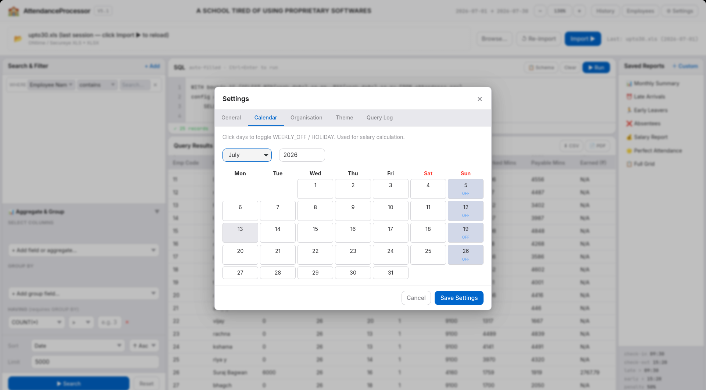
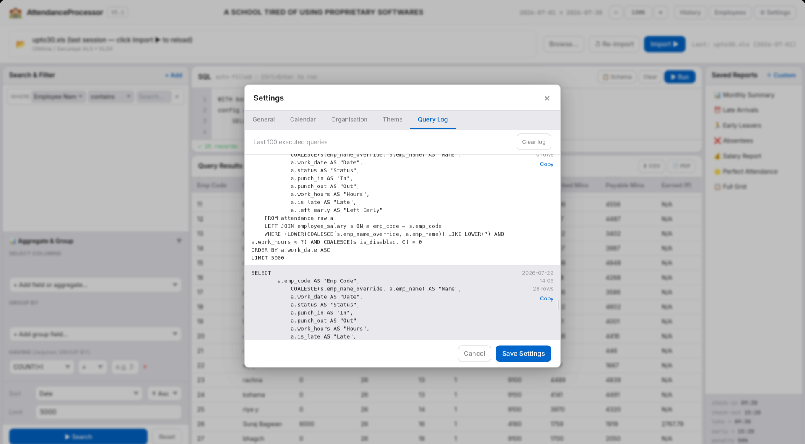
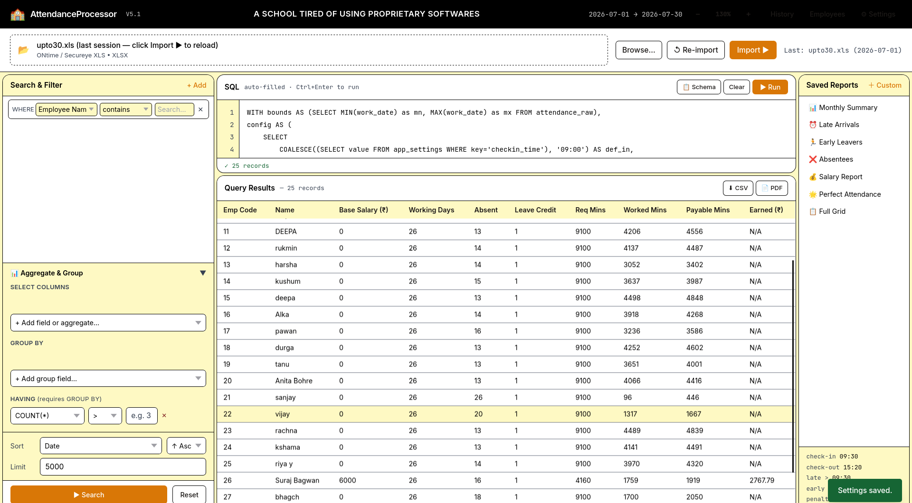
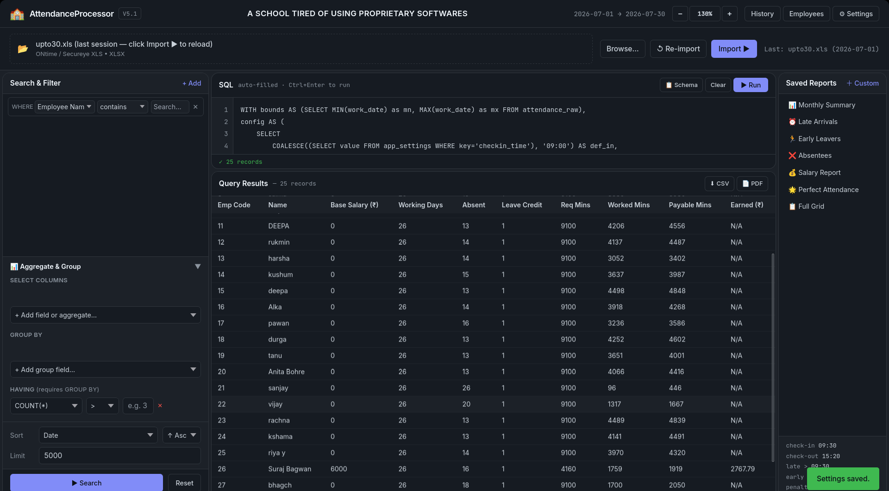

<div align="center">
  <h1>Attendance Processor V5.1</h1>
  <p><strong>A high-performance, cross-platform, native webview application for dynamic employee attendance management and precise minute-rate salary computation.</strong></p>
</div>

<br>

**Architected, tested, and maintained by Utkarsh for Sanskar Valley Higher Secondary Public School** *(Developed with AI assistance)*. 
Built to replace rigid, outdated legacy software with an ultra-flexible, completely customizable desktop platform designed for both HR admins and power users.

> **Disclaimer:** All data, names, and numbers shown in the screenshots below are entirely fabricated for testing purposes and do not belong to real individuals.

---

## 📸 Interface & Features

### The Dashboard & Dynamic SQL Engine


*(A completely bespoke reporting engine parsing dynamic SQLite constraints on the fly)*

### Granular Employee Management


*(Per-employee scheduling overrides that dynamically adapt global logic thresholds)*

### Late Arrivals & Anti-Fraud Truncation


*(Minute-rate computations dynamically isolate authorized working windows)*

### Beautiful PDF Exports


*(Pixel-perfect, un-branded landscape/portrait PDF reporting)*

---

## ⚡ Technical Architecture

Attendance Processor V5 represents a massive architectural leap, pivoting from a legacy Tkinter GUI to a highly optimized **PyWebView Single-Page Application (SPA)**.

- **Frontend:** HTML, Vanilla JS, and TailwindCSS delivering a dynamic, zero-latency desktop interface.
- **Rendering Engine:** Cross-platform native webviews (`WebKit2GTK` on Linux, `WKWebView` on macOS, `EdgeWebView2` on Windows) resulting in an extremely small binary footprint with zero Chromium bloat.
- **Backend:** Pure Python 3 with a fully decoupled SQLite database layer.
- **Reporting System:** A completely autonomous SQL-based macro system. The GUI constructs complex parameterized AST queries that compute minute-rate salaries securely at the database level using epoch string manipulation.

### Key Innovations

1. **Minute-Rate Salary Engine:** Replaced static daily wages with an ultra-precise per-minute rate mechanism calculated by evaluating strict check-in/out bounds against custom employee schedules.
2. **Paid Leave Credit:** Dynamic background formula that credits a full day's wage upon the first registered absence in a billing cycle.
3. **Anti-Fraud Execution:** Any time logged before a scheduled arrival or after a scheduled departure is silently truncated, preventing unauthorized overtime extraction.
4. **Retroactive Logic:** Late arrival and early departure reports evaluate entirely at runtime, meaning past reports instantly conform to newly updated schedule overrides.

---

## 🚀 Setup & Installation

You can run Attendance Processor in two ways: using the pre-compiled standalone binary (easiest) or running it manually via Python (for developers).

### Method 1: Direct Release (Easiest)

Download the `.exe` or `.tar.gz` from the [Releases page](https://github.com/utkarsh-brainstorm/Employee_nightmare/releases) and run it directly. 

> [!WARNING] 
> Because this application is not signed with an expensive enterprise certificate, your OS may flag it.
> 
> - **Windows:** If SmartScreen blocks it, click **More info** -> **Run anyway**.
> - **macOS:** If Gatekeeper blocks it, go to **System Settings -> Privacy & Security** and click **Open Anyway**.

### Method 2: Python / Conda Setup (For Developers)

If you want to view the source code or run the platform natively from your terminal:

1. **Clone the repository:**
   
   ```bash
   git clone https://github.com/utkarsh-brainstorm/Employee_nightmare.git
   cd Employee_nightmare
   ```

2. **Create a Conda or Python virtual environment (recommended):**
   
   ```bash
   conda create -n atndnc python=3.10
   conda activate atndnc
   ```
   
   *(Or using venv: `python -m venv venv && source venv/bin/activate`)*

3. **Install the dependencies:**
   
   ```bash
   pip install -r requirements.txt
   ```
   
   *(On Linux, you may need system WebView packages: `sudo apt-get install libgirepository1.0-dev python3-dev gir1.2-webkit2-4.1`)*

4. **Launch the application:**
   
   ```bash
   python main.py
   ```
