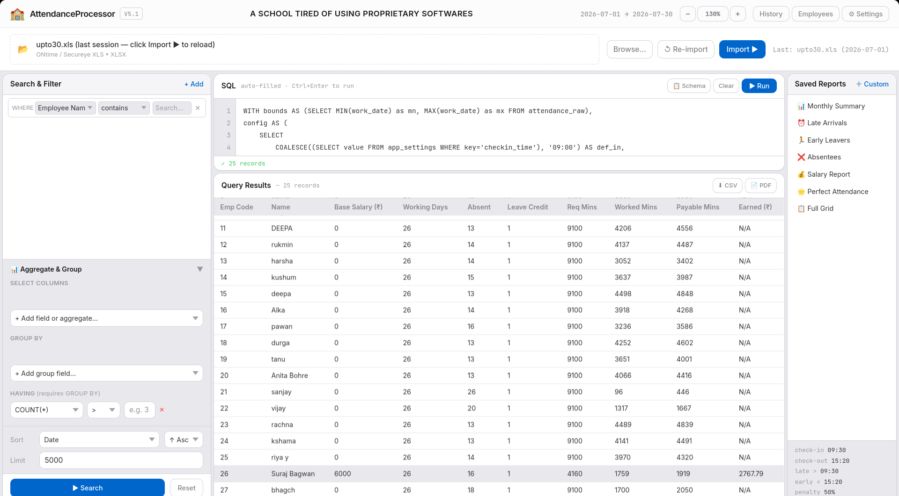

<div align="center">
  <h1>⚡ Attendance Processor Pro — V17.0</h1>
  <h3><em>Zenith Edition</em></h3>
  <p><strong>An ultra-performant, cross-platform, native desktop application for dynamic employee attendance management, mathematical invariant minute-rate salary computation, multi-day sandwich rule processing, and SQL-driven reporting.</strong></p>
  <p>
    
    
    
    
  </p>
</div>

<br>

**Architected, tested, and maintained by Utkarsh for Sanskar Valley Higher Secondary Public School** *(Developed with AI assistance)*. 
Engineered specifically to replace rigid, outdated legacy biometric software with a high-performance, completely customizable desktop platform designed for both school administrators and technical power users.

> **Disclaimer:** All data, names, and figures illustrated in sample queries and screenshots are synthetic or anonymized for demonstration and testing purposes.

---

## 🌟 What's New in V17.0 (Zenith Edition)

- ⚖️ **Mathematical Invariant Conservation:**
  
  - Guaranteed exact minute-for-minute and rupee-for-rupee conservation across every employee and summary total row:
    $$\text{Payable Minutes} + \text{Deducted Minutes} \equiv \text{Total Required Minutes}$$
    $$\text{Earned Amount} + \text{Deducted Amount} \equiv \text{Base Monthly Salary}$$
  - Net absent deduction with paid leave credit offset: $\max(0, \text{Gross Absent Mins} - \text{Leave Credit Mins})$.
  - Shortfall on attended days strictly bounded: $\max(0, \text{Required Shift} - \text{Worked Mins})$, completely preventing over-deductions on single-punch or half-day records.

- 🥪 **Contiguous Multi-Day Sandwich Chain Engine:**
  
  - Traces the entire contiguous sequence of holidays and weekly-offs adjacent to an absence (e.g. Sunday weekly-off + Monday, Tuesday, Wednesday holidays preceding an absence are all absorbed).
  - High-Alert Red badges (`.status-sandwich` with red background and dashed border) rendered across the live on-screen data grid, Ultra Dev Mode preview, and exported PDFs.

- 📊 **Unified Sandwich Absents Across Reports:**
  
  - Sandwich-absorbed days are now included in the **Absent** column across all three salary reports (**This Month Salary**, **Previous Month Salary**, and **Date Range Salary**) and in the summary TOTAL row.
  - The **Employee Wise Info** SQL macro dynamically sums both normal and sandwich-absorbed days in its summary `Total Absents:` row.

- ⏱️ **4-Tier Temporal Precedence Engine:**
  
  - Strict priority cascade for required arrival and departure timings:
    1. **Employee Day-Specific Override** *(highest priority, set in Staff Directory)*
    2. **Employee Custom Arrival/Departure Schedule** *(all-day default in Staff Directory)*
    3. **Calendar Day Required Times** *(all-staff day times from Calendar Settings)*
    4. **General Settings Times** *(global `checkin_time` / `checkout_time`)*

- 🎨 **Ultra Dev Mode PDF Engine & Chromium Paged Media:**
  
  - Live interactive PDF preview with instantaneous CSS preset switching (*Executive Slate, Minimal Monochrome, Emerald Modern, Tech Blueprint, Compact Dense*).
  - Mouse drag-resizable column widths, live CSS editor with direct disk syncing, toggleable formula breakdowns, optional watermark, and automatic special calendar schedule notes.

- 🚌 **School Bus Transport Exemption:**
  
  - Staff marked with `uses_transport=1` receive full shift credit on present days with zero late arrival or early leave minute penalties.

- 🤖 **AI Schema Reference Copilot:**
  
  - Built-in AI Schema Reference modal with one-click clipboard copying for natural language prompt-to-SQL generation.

- 📄 **Dynamic Monthly Employee Explanation Slip:**
  
  - Interactive modal dialog asking user only for Month and Employee (via instant fuzzy/substring autocomplete search across names, overrides, and codes).
  - Automatically builds a 10-column daily attendance breakdown (`Name`, `Date`, `Status`, `Req In`, `In`, `Req Out`, `Out`, `Required Min`, `Worked Min`, `Deducted Mins`) with summary totals.
  - Generates an exhaustive 5-part plain-English audit report explaining single-punch 50% shift credits, contiguous sandwich absorptions, paid free leave credits, and mathematical reconciliation.
  - Automatically launches directly into **Ultra Dev Mode** forced into **Landscape** orientation with the **Compact** theme for optimal readability and printing.

- 📋 **Accessible Data Row Copy:**
  
  - Clicking any table row toggles persistent visual highlight and reveals a floating copy pill and toolbar `📋 Copy Row` button.
  - Copies formatted data directly to clipboard formatted as:
    ```
    column name - value
    ```

---

## 📸 Interface Preview

### The Dashboard & Dynamic Reporting Engine


*(A bespoke reporting engine rendering Tailwind CSS within a native PyWebView instance)*

---

## ⚡ Technical Architecture & Stack

Attendance Processor Pro V17 avoids heavy Electron bundling bloat by leveraging OS-native WebViews, keeping the complete binary distribution under 35 MB.

```
┌────────────────────────────────────────────────────────┐
│               Frontend Presentation Layer              │
│  HTML5 + Tailwind CSS + Vanilla JS + Inter/JetBrains   │
└───────────────────────────▲────────────────────────────┘
                            │ window.pywebview.api (Bi-directional RPC)
┌───────────────────────────▼────────────────────────────┐
│                    Python API Bridge                   │
│   api.py (Settings, Reports, Calendar, Macro Engine)   │
└─────────────┬────────────────────────────┬─────────────┘
              │                            │
┌─────────────▼──────────────┐ ┌───────────▼─────────────┐
│    Salary & Query Engine   │ │     PDF Export Pipeline │
│ core/salary_engine.py      │ │ core/exporter.py        │
│ core/query_builder.py      │ │ • Rust Engine (Vector)  │
│ core/recompute.py          │ │ • Chromium Paged Media  │
│ core/parser.py             │ │ • ReportLab Fallback    │
└─────────────┬──────────────┘ └─────────────────────────┘
              │
┌─────────────▼──────────────────────────────────────────┐
│             SQLite Relational Database Layer           │
│ data/attendance.db (attendance_raw, employee_salary,   │
│ calendar_days, employee_day_overrides, app_settings)   │
└────────────────────────────────────────────────────────┘
```

- **Frontend:** Pure HTML5, Vanilla JavaScript, and Tailwind CSS. Zero dependencies, instantaneous rendering.
- **Rendering Engine:** Native OS WebView via `pywebview`:
  - **Linux:** `WebKit2GTK` (`gir1.2-webkit2-4.1`)
  - **macOS:** `WKWebView`
  - **Windows:** `Edge WebView2`
- **Database:** Normalized SQLite3 with auto-migrations, transactional safety, and parameterized queries.
- **PDF Generation:** Dual pipeline:
  - *Native Rust Engine (`querii-pdf`):* Ultra-fast vector rendering.
  - *Chromium Paged Media Engine:* Full HTML/CSS printable sheet rendering with `@page` sizing, running headers, and footers.
  - *ReportLab:* Pure Python fallback engine.

---

## 🧠 Core Engineering Specifications

### 1. The Minute-Rate Salary Computation Engine

Salaries are calculated with per-minute precision rather than arbitrary full-day or half-day deductions:

$$\text{Per-Minute Rate} = \frac{\text{Base Monthly Salary}}{\text{Total Required Monthly Minutes}}$$

- **Payable Minutes:**
  $$\text{Payable Mins} = \text{Worked Mins} + \text{Paid Holiday Mins} + \text{Leave Credit Mins}$$

- **Deducted Minutes:**
  $$\text{Net Absent Mins} = \max(0, \text{Gross Absent Mins} - \text{Leave Credit Mins})$$
  $$\text{Late/Early Shortfall} = \sum_{\text{PRESENT/HALF\_DAY}} \max(0, \text{Required Shift} - \text{Worked Mins})$$
  $$\text{Total Deducted Mins} = \text{Net Absent Mins} + \text{Late/Early Shortfall}$$

- **Conservation Invariant:**
  $$\text{Payable Mins} + \text{Total Deducted Mins} \equiv \text{Total Required Minutes}$$
  $$\text{Earned Amount} = \text{round}(\text{Per-Minute Rate} \times \text{Payable Mins}, 2)$$
  $$\text{Deducted Amount} = \text{round}(\text{Base Salary} - \text{Earned Amount}, 2)$$
  $$\text{Earned Amount} + \text{Deducted Amount} \equiv \text{Base Monthly Salary}$$

### 2. Contiguous Sandwich Rule Logic

When `sandwich_rule = 'yes'`, any contiguous sequence of holidays and weekly-offs adjacent to an absence is absorbed:

```python
# Contiguous backwards & forwards expansion
while period_start <= prev_date <= period_end:
    if prev_date in (HOLIDAY, WEEKLY_OFF):
        absorbed.add(prev_date)
        prev_date -= 1 day
    else:
        break
```

Absorbed days:

1. Shift minutes are deducted as absent time.
2. Holiday minutes are removed from paid holiday credit.
3. Days are added to the **Absent** count.
4. Rendered in high-alert red badges (`.status-sandwich`).

### 3. Temporal Precedence Hierarchy

When evaluating a staff member's required schedule on date $D$:

1. Check `employee_day_overrides` for `(emp_code, D)`. If set, use `custom_in` and `custom_out`.
2. Check `employee_salary` for `emp_code`. If `custom_arrival` and `custom_departure` are configured, use them.
3. Check `calendar_days` for date $D$. If `day_in` and `day_out` are set, use them.
4. Fall back to `app_settings` (`checkin_time` and `checkout_time`).

---

## 🗄️ Relational Database Schema

### `attendance_raw`

| Column         | Type                | Description                                              |
| -------------- | ------------------- | -------------------------------------------------------- |
| `id`           | INTEGER PRIMARY KEY | Auto-increment identifier                                |
| `report_file`  | TEXT                | Source biometric Excel filename                          |
| `emp_code`     | TEXT                | Numeric employee identifier (e.g. `'15'`)                |
| `emp_name`     | TEXT                | Name string from source file                             |
| `work_date`    | DATE                | Date in `YYYY-MM-DD` format                              |
| `status`       | TEXT                | `PRESENT`, `ABSENT`, `WEEKLY_OFF`, `HALF_DAY`, `HOLIDAY` |
| `punch_in`     | TEXT                | First arrival punch (`HH:MM`)                            |
| `punch_out`    | TEXT                | Last departure punch (`HH:MM`)                           |
| `work_minutes` | INTEGER             | Valid worked minutes inside schedule bounds              |
| `req_in`       | TEXT                | Scheduled arrival time for this day                      |
| `req_out`      | TEXT                | Scheduled departure time for this day                    |
| `is_late`      | INTEGER             | `1` if late arrival, `0` otherwise                       |
| `left_early`   | INTEGER             | `1` if early departure, `0` otherwise                    |

### `employee_salary`

| Column              | Type             | Description                                                   |
| ------------------- | ---------------- | ------------------------------------------------------------- |
| `emp_code`          | TEXT PRIMARY KEY | Employee identifier                                           |
| `emp_name`          | TEXT             | Biometric machine name                                        |
| `emp_name_override` | TEXT             | Verified administrative full name                             |
| `monthly_salary`    | REAL             | Fixed base monthly salary in ₹                                |
| `custom_arrival`    | TEXT             | Employee schedule arrival (`HH:MM`)                           |
| `custom_departure`  | TEXT             | Employee schedule departure (`HH:MM`)                         |
| `uses_transport`    | INTEGER          | `1` if school bus commuter (exempt from tardiness deductions) |
| `is_disabled`       | INTEGER          | `1` if excluded from reports, `0` if active                   |

### `employee_day_overrides`

| Column       | Type | Description                           |
| ------------ | ---- | ------------------------------------- |
| `emp_code`   | TEXT | Foreign key to `employee_salary`      |
| `date`       | DATE | Specific override date (`YYYY-MM-DD`) |
| `custom_in`  | TEXT | Special required arrival (`HH:MM`)    |
| `custom_out` | TEXT | Special required departure (`HH:MM`)  |

### `calendar_days`

| Column     | Type             | Description                            |
| ---------- | ---------------- | -------------------------------------- |
| `date`     | DATE PRIMARY KEY | Calendar date (`YYYY-MM-DD`)           |
| `day_type` | TEXT             | `HOLIDAY` or `WEEKLY_OFF`              |
| `day_in`   | TEXT             | All-staff required arrival (`HH:MM`)   |
| `day_out`  | TEXT             | All-staff required departure (`HH:MM`) |

---

## 📊 Built-In Saved Reports & SQL Macros

The application ships with 4 pre-configured production SQL macros:

1. **Full Attendance Raw:**
   Full daily punch audit with arrival, departure, worked minutes, and tardiness flags.
2. **Punctuality Report:**
   Aggregates total late arrivals, early leaves, total late/early minutes, and absents per employee, sorted by tardiness severity.
3. **Employee Wise Info:**
   Detailed individual breakdown with daily timings, worked minutes, deducted minutes, and a **TOTAL** summary row showing total required minutes, total worked minutes, and total absences (including sandwich-absorbed days).
4. **All Staff Daily Breakdown:**
   Complete cross-organization day-by-day punch analysis sorted alphabetically by employee and chronological date.

---

## 🚀 Installation & Setup

### Method 1: Pre-Compiled Executables (Recommended)

Download the latest binaries from the [GitHub Releases](https://github.com/utkarsh-brainstorm/Employee_nightmare/releases) page:

- **Windows:** Standalone `.exe` with bundled Edge WebView2 integration.
- **Linux:** `.tar.gz` package with native GTK3/WebKit2GTK binding.

### Method 2: Local Python Environment

To run or develop directly from source:

1. **Clone the repository:**
   
   ```bash
   git clone https://github.com/utkarsh-brainstorm/Employee_nightmare.git
   cd Employee_nightmare
   ```

2. **Set up a virtual environment:**
   
   ```bash
   python3 -m venv venv
   source venv/bin/activate
   ```

3. **Install dependencies:**
   
   ```bash
   pip install -r requirements.txt
   ```
   
   *Linux note:* Ensure WebKit2GTK is installed:
   
   ```bash
   sudo apt-get install python3-gi python3-gi-cairo gir1.2-webkit2-4.1
   ```

4. **Launch the application:**
   
   ```bash
   python3 main.py
   ```

---

## 🛡️ License & Copyright

Architected by **Utkarsh** for **Sanskar Valley Higher Secondary Public School** *(Developed with AI assistance)*. All rights reserved.
